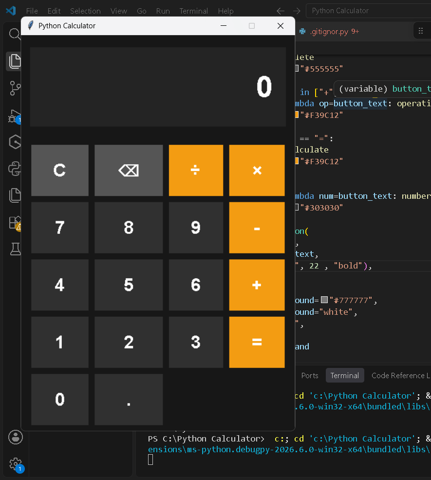

🧮 Python Calculator

A simple desktop calculator built using Python and Tkinter with a clean, modern dark-themed interface.

📌 About

I built this calculator as part of my Python learning journey. Initially, I created a basic command-line calculator, then decided to improve it by adding a graphical user interface using Tkinter.

The application allows users to perform basic mathematical calculations using clickable buttons.

✨ Features

Addition, subtraction, multiplication and division
Modern dark-themed interface
Easy-to-use calculator buttons
Clear (C) and Delete (⌫) options
Decimal number support
Division-by-zero handling
Instant calculation results

🛠️ Technologies Used

Python 3
Tkinter (GUI)
Visual Studio Code
Git & GitHub

📸 Preview

🚀 How to Run

1. Clone this repository

    git clone YOUR_REPOSITORY_LINK

2. Open the project folder

    cd Python-Calculator

3. Run the application

    python Calculator.py

Make sure Python and Tkinter are available on your system.

📚 What I Learned

While building this project, I got practical experience with:
Python functions and variables
Conditional statements
Handling user input
Creating graphical interfaces using Tkinter
Working with buttons and events
Basic error handling
Managing projects using Git and GitHub

👩‍💻 Author

Dipti khapekar

⭐ Thank You!

Thanks for visiting my Python Calculator project!